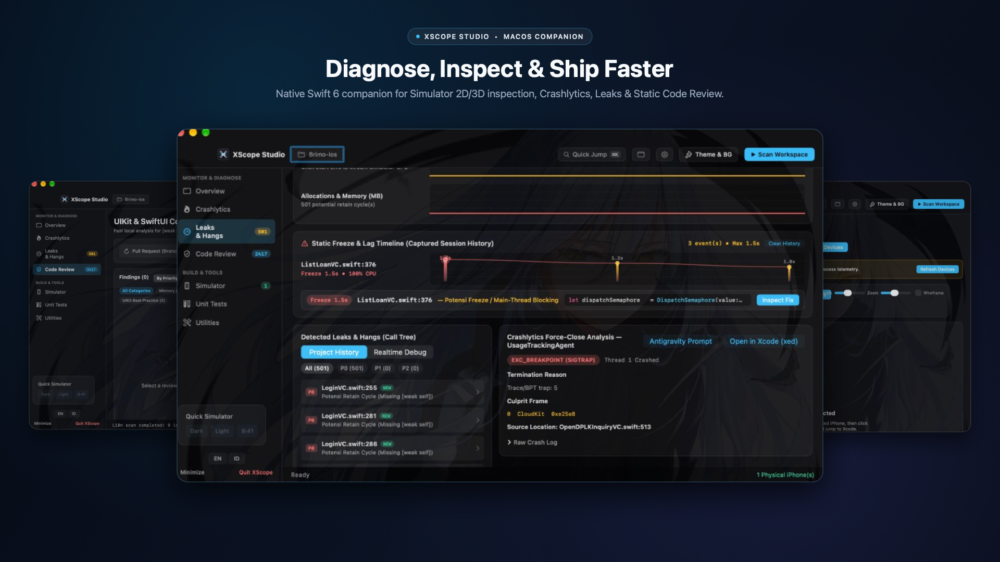
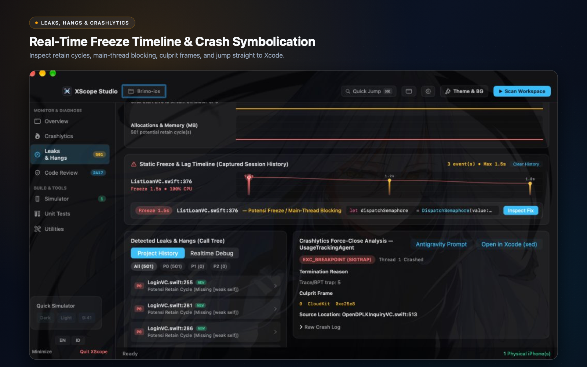
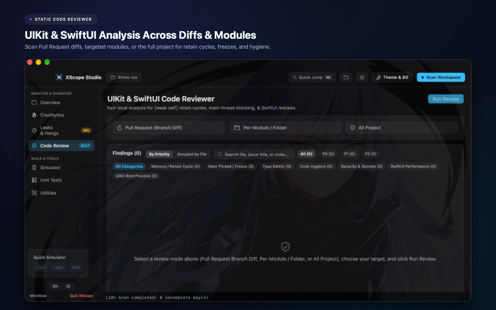
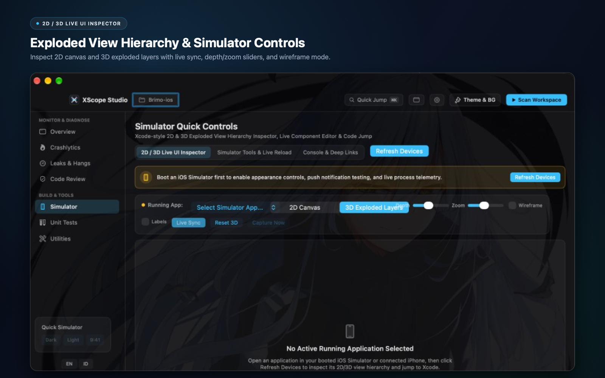

# XScope Studio

A macOS companion app for iOS app teams and developers to inspect live Simulators, diagnose crashes and freezes, review code quality, and manage daily workflows in one place.

## Preview

| Leaks, Hangs & Crashlytics | Static Code Reviewer |
| :---: | :---: |
|  |  |

| 2D / 3D Live UI Inspector |
| :---: |
|  |

## Features

### Monitor & Diagnose
- **Overview**: Live workspace summary showing active Simulators, connected iPhones, and recent diagnostic health at a glance.
- **Crashlytics**: Open crash reports, pinpoint the exact screen or line responsible for a force-close, and jump straight to the source file in Xcode.
- **Leaks & Hangs**: Track main-thread freezes on a visual timeline, spot potential memory leaks and retain cycles, and inspect suggested fixes.
- **Code Review**: Scan Pull Request changes, specific folders, or the entire project for common bugs, UI responsiveness issues, and code hygiene.

### Build & Tools
- **Simulator 2D / 3D Live UI Inspector**: View any running Simulator app in a 2D canvas or an interactive 3D exploded layer hierarchy with zoom, depth, labels, wireframe mode, and quick appearance toggles (Dark / Light / Status Bar).
- **Unit Tests**: Run and inspect test suites for your project targets and review pass/fail status without switching windows.
- **Utilities**: Manage quick developer helpers, localization checks, and color/asset utilities in one sidebar.

### Workspace Experience
- **Quick Jump (`⌘K`)**: Search files, modules, and screens instantly and open them directly at the right line.
- **Theme & Custom Background**: Personalize the workspace with translucent dark glass panels and your own custom background image.
- **Bilingual Interface (`EN` / `ID`)**: Switch cleanly between English and Bahasa Indonesia anytime.
